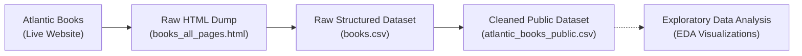

# Atlantic Books Bestseller Scraping & Data Cleaning Pipeline

[](https://www.python.org/)
[](https://www.selenium.dev/)
[](https://www.crummy.com/software/BeautifulSoup/)
[](https://pandas.pydata.org/)
[]()

An end-to-end data pipeline that automatically scrapes bestseller book listings from [Atlantic Books](https://atlanticbooks.com/), parses raw multi-page HTML into structured records, resolves metadata column shifts, normalizes pricing and categories, and outputs a clean public dataset ready for exploratory data analysis (EDA).

---

## 📌 Project Overview

Unlike clean datasets downloaded from Kaggle, real-world web data is noisy, dynamic, and full of UI artifacts. This project covers the complete data collection and preparation lifecycle:

1. **Automated Web Scraping**: Automates browser navigation through multi-page collections using Selenium, handling lazy scrolling, anti-bot preload masks, and pagination fallbacks.
2. **HTML Parsing & Card Extraction**: Climbs the DOM tree using BeautifulSoup to cleanly extract individual book card elements without bleeding into neighboring items.
3. **Data Cleaning & Shift Correction**: Resolves messy real-world scraping anomalies (such as customer review badge counts displacing metadata into subsequent columns), normalizes mixed currencies, extracts publisher imprints, and standardizes BISAC subject codes.
4. **Clean Dataset Export**: Prepares `atlantic_books_public.csv` (944 standardized book records) for downstream analytics.

---

## 🛠️ Pipeline Architecture




---

## 💡 Key Engineering & Cleaning Highlights

* **Dynamic Overlay Bypassing**: Injected JavaScript routines to detect and destroy full-screen `eb-preload-mask` overlays that obstruct element clickability.
* **Smart DOM Container Climbing (`find_card`)**: Recursively navigates upward from product links until reaching the smallest common ancestor containing exactly one product URL, preventing multi-card container bleeding.
* **Resilient Pagination**: Dual-strategy pagination that prefers semantic and position-based Next buttons, falling back to dynamic `?page=n` query parameter manipulation.
* **Metadata Shift Realignment**: Detected rows where review count badges (e.g., `(1)`, `(2)`) offset metadata across bullet columns, programmatically shifting them back into single attributes.
* **Author & Binding Sanitization**: Filtered binding/format classes (e.g. `<p class="clp-product-author binding">Paperback</p>`) where Shopify templates placed format values into author slots when metadata was missing, restoring authoritative author attribution.
* **Regex Feature Extraction**: Isolated `subject` and `bisac` classifications from composite strings using boundary pattern detection, and extracted separate `publisher` and `publisher_imprint` fields.
* **Price Standardization**: Stripped currency glyphs (`₹`, `,`), converted legacy USD entries into INR, and cast features into standard numeric types.

---

## 📁 Repository Structure

```text
Bestseller-Book-Analysis/
├── BookTrending/
│   ├── booktrending.py             # Selenium scraper (automates multi-page scraping)
│   ├── parse_books.py              # BeautifulSoup parser (HTML -> books.csv)
│   ├── booktrending_da.ipynb       # End-to-end data cleaning & preprocessing notebook
│   ├── books.csv                   # Raw parsed dataset (945 records)
│   └── atlantic_books_public.csv   # Cleaned, normalized dataset (944 records)
├── .gitignore                      # Git ignore rules for drivers, OS, and large files
├── requirements.txt                # Python dependencies
└── README.md                       # Main project documentation
```

---

## 📊 Dataset Schema (`atlantic_books_public.csv`)

| Column | Type | Description | Example |
| :--- | :--- | :--- | :--- |
| `page` | `int64` | Page number from which the book was scraped | `1` |
| `title` | `string` | Book title | `Atomic Habits` |
| `writer` | `string` | Author name | `James Clear` |
| `format` | `string` | Format (Paperback, Hardcover, etc.) | `Paperback` |
| `actual_price` | `int64` | Current selling price in INR (₹) | `650` |
| `price_before_discount` | `int64` | Original price before discount in INR (₹) | `999` |
| `discount_percent` | `float64` | Computed or listed discount percentage | `35.0` |
| `stars` | `float64` | Customer review rating (out of 5.0) | `3.5` |
| `publisher` | `string` | Primary publishing house | `Penguin` |
| `publisher_imprint` | `string` | Specific publisher imprint | `Penguin Random House` |
| `subject` | `string` | Broad category / subject area | `General Books` |
| `bisac` | `string` | Standard BISAC subject classification code | `Personal Growth - Success` |

> ℹ️ **Data Note**: In the current bestseller collection, only ~1.5% of books feature customer star ratings (`stars`), reflecting low on-site review engagement. Analysis primarily focuses on pricing dynamics, discount variance, publisher distribution, and format comparisons.

---

## 🚀 Getting Started

### 1. Clone the Repository
```bash
git clone https://github.com/DrishtiSharma7/Bestseller-Book-Analysis.git
cd Bestseller-Book-Analysis
```

### 2. Set Up Virtual Environment & Dependencies
```bash
python3 -m venv .venv
source .venv/bin/activate  # On Windows: .venv\Scripts\activate
pip install -r requirements.txt
```

### 3. Run the Scraping & Cleaning Pipeline

#### Step A: Scrape Book Listings
```bash
python BookTrending/booktrending.py
```
*Navigates Atlantic Books bestsellers collection and collects raw page sources.*

#### Step B: Parse HTML into Structured CSV
```bash
python BookTrending/parse_books.py
```
*Extracts titles, prices, authors, formats, and bullet metadata into `books.csv`.*

#### Step C: Execute Data Cleaning & Normalization
```bash
jupyter notebook BookTrending/booktrending_da.ipynb
```
*Executes the 10-step data cleaning pipeline and outputs `atlantic_books_public.csv`.*

---

## 🛣️ Roadmap & Next Steps

- [x] Automated multi-page Selenium scraper with mask and pagination handlers
- [x] Card parsing and structured raw CSV extraction
- [x] Metadata column shift recovery and classification parsing
- [x] Currency normalization and cleaned public CSV export
- [ ] **Exploratory Data Analysis (EDA)**:
  - Price distribution across book formats (Paperback vs. Hardcover)
  - Top 10 publishers dominating the bestseller lists
  - Discount spread analysis across different BISAC subjects

---

## ⚖️ Disclaimer

This project is created strictly for educational and portfolio demonstration purposes. All book metadata belongs to their respective publishers and Atlantic Books. Please review the website's Terms of Service and `robots.txt` before running the scraper.
